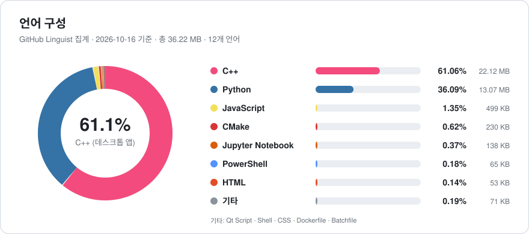

<div align="center">

<a href="https://extriver.com"></a>

# Extriver Terminal

**한국 투자자를 위한 올인원 금융 터미널**

[](https://extriver.com)
[](https://www.linkedin.com/company/pnexus/)

    [](LICENSE)

[](https://github.com/HyeonbinJung/Extriver-Terminal/stargazers)
[](https://github.com/HyeonbinJung/Extriver-Terminal/network/members)
[](https://github.com/HyeonbinJung/Extriver-Terminal/watchers)

[](https://github.com/HyeonbinJung/Extriver-Terminal/commits/main)
[](https://github.com/HyeonbinJung/Extriver-Terminal/graphs/commit-activity)
[](https://github.com/HyeonbinJung/Extriver-Terminal/issues)
[](https://github.com/HyeonbinJung/Extriver-Terminal)
[](https://github.com/HyeonbinJung/Extriver-Terminal)
[](https://github.com/HyeonbinJung/Extriver-Terminal)

</div>

---

## 소개

**Extriver Terminal**은 [**Fincept Terminal**](https://github.com/Fincept-Corporation/FinceptTerminal)을 베이스로 만들어졌으며,
[**GS Quant**](https://github.com/goldmansachs/gs-quant) · [**미다스 터미널 (Midas Terminal)**](https://github.com/HyeonbinJung/Midas-Terminal) · [**OpenBB**](https://github.com/OpenBB-finance/OpenBB) · [**Qlib**](https://github.com/microsoft/qlib) · [**QuantConnect LEAN**](https://github.com/QuantConnect/Lean) · [**vn.py**](https://github.com/vnpy/vnpy) · [**Ghostfolio**](https://github.com/ghostfolio/ghostfolio) · [**Zipline**](https://github.com/quantopian/zipline) · [**Backtrader**](https://github.com/mementum/backtrader) 등
유명한 금융 터미널·퀀트 플랫폼의 기능을 모두 포함시켜 **한 곳에서 사용할 수 있도록** 하였습니다.

추가로 **금융 초보자도 쉽게 접근할 수 있도록** 설계하였습니다.

Extriver Terminal은 두 가지 형태로 제공됩니다.

| 형태 | 대상 | 특징 |
| --- | --- | --- |
| 🌐 **웹 터미널** ([`easy/`](easy/README.md)) | 처음 시작하는 분, 가볍게 쓰고 싶은 분 | 설치·빌드·API 키·로그인 없이 브라우저에서 바로 실행. 16개 화면, 전부 한국어 |
| 🖥️ **데스크톱 앱** ([`fincept-qt/`](fincept-qt/)) | 전문 분석·트레이딩이 필요한 분 | C++20 · Qt6 네이티브 앱. 51개 화면, AI 에이전트, 브로커 연동, 노드 에디터까지 전체 기능 |

---

## 이런 분들께 추천합니다

- 📚 **주식을 처음 시작하는 분** — PER, 배당수익률, 변동성 같은 용어를 화면에서 바로 풀이해 줍니다.
- 💼 **직접 포트폴리오를 관리하는 개인 투자자** — 국내·해외 주식을 원화 기준으로 한 번에 관리하고, 위험도와 리밸런싱까지 계산합니다.
- 🧪 **전략을 검증하고 싶은 분** — 코딩 없이 매매 전략을 과거 데이터로 백테스트하고 결과를 비교합니다.
- 🎓 **금융·퀀트를 공부하는 학생** — 옵션 가격 결정, 몬테카를로 시뮬레이션, 팩터 분석을 직접 돌려 보며 배울 수 있습니다.
- 🏦 **전문 리서처·트레이더** — 여러 터미널을 오가지 않고 리서치부터 백테스트, 주문까지 한 곳에서 처리합니다.

---

## 주요 기능

### 📊 시장 한눈에 보기
- **대시보드**: 코스피·나스닥·S&P 500 등 글로벌 지수, 원/달러 환율, 금·유가 같은 원자재, 국채 금리, 비트코인 시세를 한 화면에 모았습니다.
- **시장 심리**: 공포·탐욕 지수, VIX(변동성 지수), 상승·하락 종목 수로 지금 시장 분위기를 숫자로 보여 줍니다.
- **섹터 히트맵**: 어떤 업종이 오르고 내리는지 색으로 바로 보이고, 1일~1년 기간별 섹터 수익률(섹터 로테이션)을 비교할 수 있습니다.
- **거래소 개장 시간**: 한국·미국·유럽·아시아 거래소가 지금 열려 있는지 표시합니다.

### 📰 뉴스
- 국내 매체 9곳을 포함한 **RSS 40개**를 실시간으로 모아 보여 줍니다.
- 기사마다 **긍정·부정 감성**과 **시장 영향도**를 분류하고, 기사에 나온 종목(`$AAPL` 등)을 태그로 뽑아 줍니다.
- 속보 배너, 관련 기사 묶음, 북마크 기능을 제공합니다.

### 🔎 종목 리서치
- 종목 코드(`005930.KS`, `AAPL`)나 회사 이름만 입력하면 분석 화면이 열립니다.
- **개요**: 캔들 차트, 시가총액·PER·PBR 등 밸류에이션, 애널리스트 목표가
- **재무제표**: 손익계산서·재무상태표·현금흐름표 (연간·분기)
- **기술적 분석**: 이동평균, RSI, MACD, 볼린저 밴드 등 13종 지표와 매수·매도 신호 요약
- **가치 평가**: DCF(현금흐름 할인) 모델과 동종업체 대비 상대가치 평가
- **그 밖에**: 동종업체 비교, 애널리스트 의견, 주요 주주, 배당 이력, 종목 뉴스

### 💼 포트폴리오
- 매수·매도·배당 거래를 기록하면 **보유 현황과 손익을 원화·달러로 자동 계산**합니다.
- 벤치마크(코스피, S&P 500 등) 대비 성과를 비교합니다.
- **위험 분석**: VaR·CVaR(최대 예상 손실), 시장 급락 상황을 가정한 스트레스 테스트
- **최적화**: 최대 샤프 비율, 최소 변동성, 위험 균형 포트폴리오를 계산하고 리밸런싱 방법을 알려 줍니다.
- 보유 종목 간 상관관계를 히트맵으로 보여 줍니다.

### 🧪 백테스트 · 퀀트 연구
- 이동평균 교차, RSI, 볼린저 밴드 등 **8가지 전략**을 과거 데이터로 시험합니다.
- 차트에 매수·매도 시점을 표시하고, 자산 곡선·최대 낙폭·월별 수익률을 보여 줍니다.
- 여러 전략을 나란히 비교하고, 파라미터 조합별 성과를 히트맵으로 찾아 줍니다.
- **퀀트 랩**: 몬테카를로 시뮬레이션, 수익률 분포, 계절성, CAPM 회귀(베타), 롤링 지표, 페어 트레이딩(공적분), 팩터 노출 분석

### 📈 파생상품 · 채권
- **옵션 체인**: 실제 시장의 옵션 가격, 풋/콜 비율, 맥스 페인, 내재변동성 스마일
- **옵션 계산기**: 블랙-숄즈·이항모형 가격과 그릭스, 내재변동성 역산
- **전략 빌더**: 커버드콜, 스트래들, 아이언 콘도르 등 11가지 옵션 전략의 손익 그래프
- **채권 계산기**: 가격·수익률·듀레이션·볼록성, 이자 지급 일정
- **VIX**: 변동성 기간구조와 선물 곡선

### 🌏 경제 지표
- 세계은행 데이터로 **한국과 다른 나라의 GDP·물가·실업률 등을 비교**합니다.
- 미국 국채 수익률 곡선과 장단기 금리차(경기 침체 신호)
- IMF 경제 전망, 유럽중앙은행(ECB) 금리, OECD 경기선행지수, DBnomics 데이터 검색

### 🪙 크립토 · 환율 · 예측시장
- **크립토**: 시가총액 상위 100개 코인, 비트코인 도미넌스, 트렌딩 코인, 원화 환산 가격
- **환율**: 27개 통화 계산기, 원화 기준 환율표, 교차 환율
- **예측시장**: Polymarket·Kalshi의 선거·경제 이벤트 확률과 추이

### 🧰 도구
- **스크리너**: 한국 시장을 포함한 조건 검색과 기본 스크린 19개
- **관심종목**: 여러 목록 관리, 실시간 시세와 미니 차트, CSV 가져오기·내보내기
- **금융 계산기**: 복리, 대출 상환, 은퇴 자금, 연평균 수익률(CAGR), 평균 단가, 세후 수익
- **노트**: 투자 아이디어 메모

### 🤖 데스크톱 앱 전용 고급 기능
데스크톱 앱에서는 위 기능에 더해 다음을 쓸 수 있습니다.

| 분야 | 기능 |
| --- | --- |
| **AI** | 37종 투자자·경제·지정학 AI 에이전트, 금융 AI 채팅, 에이전트 스튜디오 (OpenAI·Anthropic·Gemini·DeepSeek·Ollama 등 원하는 LLM 키 사용) |
| **트레이딩** | 주식·암호화폐 트레이딩, 선물·옵션, 알고리즘 트레이딩, 모의 투자 엔진, 16개 증권사 연동 |
| **퀀트** | AI 퀀트 연구소(머신러닝·팩터 발굴·강화학습), QuantLib 18개 모듈, 변동성 곡면 |
| **자동화** | 노드 에디터로 분석 흐름 만들기, 코드 에디터(노트북), MCP 서버 |
| **데이터** | FRED·IMF·세계은행·AKShare 등 100개 이상의 데이터 커넥터, 아시아 시장 |
| **글로벌 인텔리전스** | 지정학 분석, 해운 추적, 무역 흐름 시각화 |
| **업무 도구** | 리포트 빌더, 스프레드시트, 파일 관리자 |

---

## 금융 초보자를 위한 설계

전문가용 터미널은 기능은 많지만 처음 보면 무엇부터 해야 할지 알기 어렵습니다. Extriver Terminal은 처음 쓰는 사람도 바로 시작할 수 있도록 다음을 갖췄습니다.

1. **모든 화면이 한국어** — 메뉴, 표, 그래프, 설명까지 전부 한국어입니다.
2. **용어 풀이** — 점선 밑줄이 있는 금융 용어(PER, 샤프 비율, VaR 등)에 마우스를 올리면 쉬운 설명이 나옵니다.
3. **설치 없이 시작** — 웹 터미널은 실행 파일 하나만 누르면 열리고, 회원가입이나 API 키가 필요 없습니다.
4. **한국 시장 우선** — 국내 종목(`.KS`, `.KQ`), 원화 환산, 국내 뉴스 매체, 한국 거래소 시간을 기본으로 지원합니다.
5. **검색 하나로 이동** — 상단 명령줄에 종목 코드·회사 이름·명령어(`/fx 100 USD KRW`)를 입력하면 해당 화면으로 바로 이동합니다.
6. **기능 안내 화면** — 51개 전체 기능이 각각 무엇을 하고 무엇이 필요한지(API 키, 증권 계좌, 로그인 등) 한 화면에 정리되어 있습니다.

---

## 빠른 시작

### 🌐 웹 터미널 (추천 · 설치 없음)

**준비물**: [Python 3.10 이상](https://www.python.org/downloads/)

| 운영체제 | 실행 방법 |
| --- | --- |
| Windows | `easy\run.bat` 더블클릭 |
| macOS / Linux | 터미널에서 `sh easy/run.sh` |
| 직접 실행 | `pip install -r easy/requirements.txt` 후 `python easy/server.py --port 8770` |

처음 실행하면 필요한 패키지를 자동으로 설치합니다. 실행 후 브라우저에서 **http://127.0.0.1:8770** 을 열면 됩니다.

**기본 사용법**
- 상단 탭 또는 **F1~F10** 키로 화면을 옮깁니다.
- **Ctrl+K** 로 명령줄을 열고 종목 코드나 회사 이름을 입력합니다.
- 자주 쓰는 명령어: `/fx 100 USD KRW` (환율), `/opt SPY` (옵션), `/eco KOR` (경제), `/yc` (수익률 곡선), `/screen` (스크리너), `/news` (뉴스)
- 관심종목·포트폴리오·노트는 사용 중인 브라우저에 저장됩니다.

자세한 내용은 [easy/README.md](easy/README.md)를 참고하세요.

### 🖥️ 데스크톱 앱 (고급)

C++20 · Qt6 네이티브 앱은 소스에서 빌드합니다.

```sh
# Linux / macOS
./setup.sh
```

Windows 빌드, 필요한 도구 버전(CMake 3.27.7 · Ninja 1.11.1 · Qt 6.8.3 · Python 3.11.9), 문제 해결 방법은 [docs/GETTING_STARTED.md](docs/GETTING_STARTED.md)에 있습니다.

---

## 데이터 출처

| 데이터 | 출처 |
| --- | --- |
| 주식·지수·환율·원자재·옵션 | Yahoo Finance |
| 암호화폐 | CoinGecko, alternative.me (공포·탐욕 지수) |
| 경제 지표 | 세계은행, IMF, 미국 연준·재무부, ECB, OECD, DBnomics |
| 변동성 | CBOE |
| 예측시장 | Polymarket, Kalshi |
| 뉴스 | 국내외 언론사 RSS 40개 |

웹 터미널은 API 키가 필요 없는 공개 데이터만 사용합니다. 데스크톱 앱에서는 본인의 API 키를 등록해 유료 데이터와 실시간 시세를 연결할 수 있습니다.

---

## 폴더 구성

```
easy/                한국어 웹 터미널
  server.py          로컬 웹 서버
  api/               화면별 데이터 API (Python)
  static/            화면 (HTML · CSS · JavaScript)
fincept-qt/          데스크톱 앱
  src/               C++20 · Qt6 소스
  scripts/           Python 분석·데이터 스크립트 (웹 터미널도 함께 사용)
docs/                개발 문서
images/              README 이미지
```

---

## 저장소 통계

<picture>
  <source media="(prefers-color-scheme: dark)" srcset="images/languages-dark.svg" />
  <source media="(prefers-color-scheme: light)" srcset="images/languages-light.svg" />
  
</picture>

C++는 데스크톱 앱 본체, Python은 데이터 수집·분석 스크립트와 웹 터미널 서버, JavaScript·HTML·CSS는 웹 터미널 화면입니다.

### 스타 추이

<a href="https://star-history.com/#HyeonbinJung/Extriver-Terminal&Date">
 <picture>
   <source media="(prefers-color-scheme: dark)" srcset="https://api.star-history.com/svg?repos=HyeonbinJung/Extriver-Terminal&type=Date&theme=dark" />
   <source media="(prefers-color-scheme: light)" srcset="https://api.star-history.com/svg?repos=HyeonbinJung/Extriver-Terminal&type=Date" />
   
 </picture>
</a>

---

## 기여자

Extriver Terminal은 [**Extriver Partners**](https://extriver.com) 팀이 만들고 있습니다.

<table>
  <tr>
    <td align="center" width="33%">
      <a href="https://github.com/HyeonbinJung"></a><br/>
      <b>정현빈</b><br/>
      <sub>Hyeonbin Jung</sub><br/>
      <sub><b>Founder · CTO</b><br/>퀀트 리서치 · 엔지니어링</sub><br/>
      <sub>컬럼비아대학교<br/>컴퓨터과학·수학</sub><br/>
      <a href="https://github.com/HyeonbinJung"></a>
      <a href="https://www.linkedin.com/in/hyeonbin-jung-a49b79274/"></a>
    </td>
    <td align="center" width="33%">
      <br/>
      <b>서인덕</b><br/>
      <sub>Indeok Seo</sub><br/>
      <sub><b>Research Head</b><br/>감사 · 리서치</sub><br/>
      <sub>포항공과대학교 (POSTECH)<br/>컴퓨터공학과</sub>
    </td>
    <td align="center" width="33%">
      <br/>
      <b>조서원</b><br/>
      <sub>Seowon Cho</sub><br/>
      <sub><b>CEO</b><br/>Chief Executive Officer</sub><br/>
      <sub>서울대학교<br/>경제학부</sub>
    </td>
  </tr>
</table>

---

## 출처

- 베이스: [Fincept Terminal](https://github.com/Fincept-Corporation/FinceptTerminal) — © Fincept Corporation, AGPL-3.0
- 참고 프로젝트: [GS Quant](https://github.com/goldmansachs/gs-quant) · [Midas Terminal](https://github.com/HyeonbinJung/Midas-Terminal) · [OpenBB](https://github.com/OpenBB-finance/OpenBB) · [Qlib](https://github.com/microsoft/qlib) · [QuantConnect LEAN](https://github.com/QuantConnect/Lean) · [vn.py](https://github.com/vnpy/vnpy) · [Ghostfolio](https://github.com/ghostfolio/ghostfolio) · [Zipline](https://github.com/quantopian/zipline) · [Backtrader](https://github.com/mementum/backtrader)

Extriver Terminal은 위 프로젝트들의 공식 제품이 아니며, 각 소유자와 관계가 없습니다.
"Fincept", "Fincept Terminal" 및 관련 로고는 Fincept Corporation의 상표입니다.

## 라이선스

원본과 같은 **AGPL-3.0-or-later**를 따릅니다. 전문은 [LICENSE](LICENSE)를 참고하세요.

## 면책

모든 데이터는 공개 소스에서 가져오며 지연되거나 빠질 수 있습니다. 모든 수치와 분석은 학습·참고용이며 **투자 권유가 아닙니다.** 투자 판단과 그 결과의 책임은 투자자 본인에게 있습니다.

---

<div align="center">

**[Extriver Partners](https://extriver.com)** · [LinkedIn](https://www.linkedin.com/company/pnexus/)

</div>
