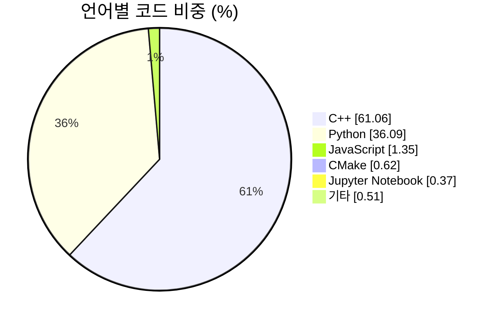

<div align="center">

<a href="https://extriver.com"></a>

# Extriver Terminal

**한국 투자자를 위한 올인원 금융 터미널**

[](https://extriver.com)
[](https://www.linkedin.com/company/pnexus/)

    [](LICENSE)

[](https://github.com/HyeonbinJung/Extriver-Terminal/stargazers)
[](https://github.com/HyeonbinJung/Extriver-Terminal/network/members)
[](https://github.com/HyeonbinJung/Extriver-Terminal/watchers)

[](https://github.com/HyeonbinJung/Extriver-Terminal/commits/main)
[](https://github.com/HyeonbinJung/Extriver-Terminal/graphs/commit-activity)
[](https://github.com/HyeonbinJung/Extriver-Terminal/issues)
[](https://github.com/HyeonbinJung/Extriver-Terminal)
[](https://github.com/HyeonbinJung/Extriver-Terminal)
[](https://github.com/HyeonbinJung/Extriver-Terminal)

</div>

---

## 소개

**Extriver Terminal**은 [**Fincept Terminal**](https://github.com/Fincept-Corporation/FinceptTerminal)을 베이스로 만들어졌으며,
[**GS Quant**](https://github.com/goldmansachs/gs-quant) · [**미다스 터미널 (Midas Terminal)**](https://github.com/HyeonbinJung/Midas-Terminal) · [**OpenBB**](https://github.com/OpenBB-finance/OpenBB) · [**Qlib**](https://github.com/microsoft/qlib) · [**QuantConnect LEAN**](https://github.com/QuantConnect/Lean) · [**vn.py**](https://github.com/vnpy/vnpy) · [**Ghostfolio**](https://github.com/ghostfolio/ghostfolio) · [**Zipline**](https://github.com/quantopian/zipline) · [**Backtrader**](https://github.com/mementum/backtrader) 등
유명한 금융 터미널·퀀트 플랫폼의 기능을 모두 포함시켜 **한 곳에서 사용할 수 있도록** 하였습니다.

추가로 **금융 초보자도 쉽게 접근할 수 있도록** 설계하였습니다.

---

## 주요 기능

| 분야 | 할 수 있는 일 |
| --- | --- |
| 📊 **시장** | 국내외 지수·환율·원자재·채권 금리·크립토 시세, 섹터 히트맵, 공포·탐욕 지수, 거래소 개장 시간 |
| 📰 **뉴스** | 국내 매체를 포함한 RSS 40개 실시간 모아보기, 감성·영향도 분류, 속보 알림 |
| 🔎 **종목 리서치** | 캔들 차트, 재무제표, 기술적 분석, DCF·상대가치 평가, 동종업체 비교, 애널리스트 의견, 배당 |
| 💼 **포트폴리오** | 거래 기록, 원화 환산 손익, VaR·스트레스 테스트, 최적화·리밸런싱, 상관관계 |
| 🧪 **백테스트·퀀트** | 전략 백테스트와 비교, 파라미터 최적화, 몬테카를로, 팩터 분석, 페어 트레이딩 |
| 📈 **파생상품·채권** | 실제 옵션 체인, 옵션 가격 계산기(BSM·이항모형), 전략 빌더, 채권 계산기, VIX 기간구조 |
| 🌏 **경제** | 세계은행·IMF·ECB·OECD 지표, 미국 수익률 곡선, 국가 비교 |
| 🤖 **AI** | 투자자·경제·지정학 AI 에이전트, 금융 AI 채팅 (원하는 LLM 키 사용) |
| 🧰 **도구** | 스크리너(한국 시장 포함), 관심종목, 환율 계산기, 예측시장, 복리·대출·은퇴 계산기 |

## 금융 초보자를 위한 설계

- **모든 화면이 한국어**입니다.
- 어려운 금융 용어에 마우스를 올리면 **쉬운 설명**이 나옵니다.
- **설치·빌드·API 키 없이** 브라우저에서 바로 시작할 수 있습니다.
- 종목 코드(`005930.KS`, `AAPL`)나 회사 이름만 입력하면 분석 화면이 열립니다.
- **기능 안내** 화면에서 각 기능이 무엇을 하고 무엇이 필요한지 한눈에 볼 수 있습니다.

---

## 빠른 시작

### 웹 터미널 (추천 · 설치 없음)

| 운영체제 | 방법 |
| --- | --- |
| Windows | `easy\run.bat` 더블클릭 |
| macOS / Linux | `sh easy/run.sh` |

브라우저에서 **http://127.0.0.1:8770** 을 엽니다. (Python 3.10 이상 필요)

자세한 사용법은 [easy/README.md](easy/README.md)를 참고하세요.

### 데스크톱 앱 (고급)

C++20 · Qt6 네이티브 앱은 소스에서 빌드합니다. 빌드 방법은 [docs/GETTING_STARTED.md](docs/GETTING_STARTED.md)를 참고하세요.

```sh
# Linux / macOS
./setup.sh
```

---

## 폴더 구성

```
easy/          한국어 웹 터미널 (브라우저용, 초보자 추천)
fincept-qt/    데스크톱 앱 소스 (C++20 · Qt6 · 내장 Python 분석 스크립트)
docs/          개발 문서
```

---

## 저장소 통계

### 언어 구성

<sub>2026-10-16 기준 · GitHub Linguist 집계 (총 약 36.2MB)</sub>



| 언어 | 비중 | 크기 |
| --- | ---: | ---: |
| C++ | 61.06% | 22.12 MB |
| Python | 36.09% | 13.07 MB |
| JavaScript | 1.35% | 0.49 MB |
| CMake | 0.62% | 0.22 MB |
| Jupyter Notebook | 0.37% | 0.13 MB |
| PowerShell | 0.18% | 0.06 MB |
| HTML | 0.14% | 0.05 MB |
| Qt Script · Shell · CSS · Dockerfile · Batchfile | 0.19% | 0.07 MB |

### 활동

<a href="https://star-history.com/#HyeonbinJung/Extriver-Terminal&Date">
 <picture>
   <source media="(prefers-color-scheme: dark)" srcset="https://api.star-history.com/svg?repos=HyeonbinJung/Extriver-Terminal&type=Date&theme=dark" />
   <source media="(prefers-color-scheme: light)" srcset="https://api.star-history.com/svg?repos=HyeonbinJung/Extriver-Terminal&type=Date" />
   
 </picture>
</a>

---

## 출처

- 베이스: [Fincept Terminal](https://github.com/Fincept-Corporation/FinceptTerminal) — © Fincept Corporation, AGPL-3.0
- 참고 프로젝트: [GS Quant](https://github.com/goldmansachs/gs-quant) · [Midas Terminal](https://github.com/HyeonbinJung/Midas-Terminal) · [OpenBB](https://github.com/OpenBB-finance/OpenBB) · [Qlib](https://github.com/microsoft/qlib) · [QuantConnect LEAN](https://github.com/QuantConnect/Lean) · [vn.py](https://github.com/vnpy/vnpy) · [Ghostfolio](https://github.com/ghostfolio/ghostfolio) · [Zipline](https://github.com/quantopian/zipline) · [Backtrader](https://github.com/mementum/backtrader)

Extriver Terminal은 위 프로젝트들의 공식 제품이 아니며, 각 소유자와 관계가 없습니다.
"Fincept", "Fincept Terminal" 및 관련 로고는 Fincept Corporation의 상표입니다.

## 라이선스

원본과 같은 **AGPL-3.0-or-later**를 따릅니다. 전문은 [LICENSE](LICENSE)를 참고하세요.

## 면책

모든 데이터는 공개 소스에서 가져오며 지연되거나 빠질 수 있습니다. 모든 수치와 분석은 학습·참고용이며 **투자 권유가 아닙니다.**
